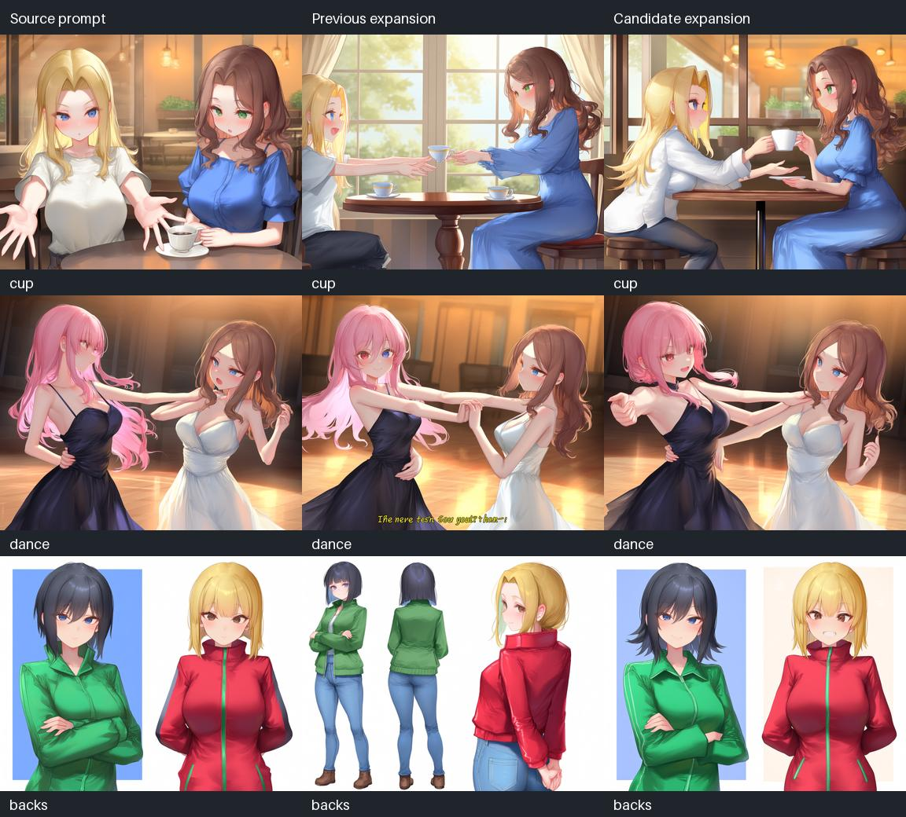

> Historical standalone TIPO implementation/test record. The current active node uses Gemma + TIPO LoRA. See [current usage](usage.ko.md) and [Gemma validation](gemma-tipo-validation.md).

# 역할을 보존하는 적은 보강: 구현과 실제 이미지 비교

이 변경은 `RS TIPO Prompt (Experimental)`의 캐릭터별 보강을 조정합니다.
TIPO 가중치나 다음 토큰 선택을 바꾼 것이 아니라, **동일한 모델 후보 중
실제로 붙일 태그를 선택하는 규칙과 개수 상한**을 개선했습니다.
0.1.1의 생성 단계 제외 태그 기능은 별도로 유지됩니다.

## 변경한 동작

- 원문과 가중치를 보존하고, 각 캐릭터의 원래 행동과 원래 전역 행동을 기준으로 선택합니다.
  다른 캐릭터의 역할·외형을 새 태그의 근거로 쓰지 않습니다.
- `offering cup`에 `holding cup`, `extending arms`에 `outstretched hand`처럼
  유용한 손동작을 허용합니다. 기본 자세·표정·상대 시선도 제한적으로 허용합니다.
  전혀 요청하지 않은 펜·접시·커튼 등은 캐릭터 추가 목록에서 제외합니다.
- 영어 동작의 일부 동의어를 인식해 이미 적힌 의미의 반복을 줄입니다.
  보강할 후보가 없으면 원문을 그대로 반환합니다.
- 고급 설정 `max_added_tags`는 출력 하나당 추가 개수 상한이며 기본 6, 범위 1~32입니다.
  원문과 중복은 개수에서 제외하며 상한을 채우기 위해 생성하지 않습니다.
- `protect_source`를 끄면 행동 근거 선택은 꺼지고 개수 상한은 남습니다.
  전역 출력은 기존 보호와 개수 상한을 적용합니다.
- 신규 위젯은 기존 `excluded_tags` 뒤에 추가했습니다. 구형 워크플로의
  위치 기반 저장값과 기존 출력 번호를 보존합니다.

## 시험 조건

실제 TIPO 모델은 공식 revision `f5a318524a4ab30cdbbf51816cf406170f454e65`입니다.
텍스트 시드 8910, temperature 0, 최대 96토큰으로 컵 전달·춤·등 맞대기
각 2명, 총 6개의 캐릭터 보강을 시험했습니다. 이전 선택과 초기 수정 선택의
생성 토큰이 같은지 확인했습니다. 최종 규칙 조정은 **같은 실제 후보를 재사용**했습니다.
따라서 생성 모델 자체의 이해력 향상 실험으로 해석하면 안 됩니다.
6개 캐릭터 출력의 추가 태그 합계는 기존 64개에서 수정안 12개로 줄었습니다.
이 개수 자체는 이미지 품질 지표가 아닙니다.

이미지 비교는 원문 / 기존 보강 / 수정 보강의 3열, 3장면 총 9장입니다.
Anima base v1.0, RSCV5 15,000 step LoRA 전역 강도 0.9,
1152×896, 30 steps, CFG 4, Euler ancestral + SGM uniform,
이미지 시드 891024073, 2개의 리저널 포인트 (0.28, 0.5)와 (0.72, 0.5)를
모든 열에 고정했습니다. 이번에는 마스크나 디테일러를 추가하지 않았습니다.
5060을 사용하는 별도 시험 서버에서 실행했고 사용자의 4070 작업은 계속 유지했습니다.

## 관찰 결과



| 장면 | 기존 보강 | 수정 보강과 남은 문제 |
|---|---|---|
| 컵 전달 | 컵 전달 구도가 나오지만 중복 컵·찻잔·받침 등 무관한 후보가 많음 | 한 사람이 컵을 내밀고 상대가 손을 펴는 전달 구도 유지. 손가락·역할의 완벽한 재현은 아님 |
| 춤 | 실제 결과에 불필요한 자막이 나타남 | 자막 없이 춤 구도를 유지. 지정한 손 위치·리드/팔로우를 정확히 실현했다고 판정하지 않음 |
| 등 맞대기 | `multiple views` 등으로 인물 반복·여러 시점이 나타남 | 반복 인물은 줄었지만 원문과 수정안 모두 실제 등 맞대기에는 실패 |

처음에는 기본 자세나 손동작까지 너무 엄격히 제한했습니다. 그 시험에서는
컵 전달이 기존 보강보다 약해져서 기본값으로 채택하지 않았습니다.
최종 규칙은 유용한 자세·손동작을 다시 허용한 버전입니다.

큐 제출부터 파일 확인까지 장당 약 37~38초였습니다. 폴링 간격과 파일 읽기를
포함하므로 정밀한 샘플링 성능 비교가 아닙니다. 태그 선택을 줄여도 TIPO는
동일한 토큰 예산으로 생성하므로 텍스트 추론 가속을 주장하지 않습니다.

한 이미지 시드·한 모델·한 스타일 LoRA로 한 소규모 비교입니다.
성공률이나 다른 모델의 품질 향상은 검증하지 않았습니다. 원문 보호가 켜져도
제한된 영어 어휘를 이용한 규칙이므로 애매한 역할·동의어·부정문을 전부
이해하지는 못합니다. 기본 자세나 표정까지 바뀌지 않길 원하면 원문에 적으세요.

## 재현 자료와 검증

- [실제 TIPO 출력·생성 토큰·추가/제외 내역](role-study/prompts.json)
- [9장 API 그래프·prompt ID·픽셀 SHA-256·소요시간](role-study/images.json)
- Python 자동 검사 73개, JS 검사 파일 3개 통과.
- 현재 설치본과 ComfyUI v0.3.26 / frontend 1.11.8에서
  캐릭터 수 변경, 연결 보존, 위젯 위치, 저장·재불러오기와 오류 없는 화면 동작 확인.
- 두 시험 서버에서 실제 `RSTIPOPrompt` 컵 전달 실행 성공.
  Windows나 오래된 PyTorch에서 이번 변경을 새로 시험한 것은 아닙니다.

아래의 이미지 시험은 지정 서버의 큐가 비어 있고 5060으로 확인될 때만 실행합니다.
모델과 RSCV5 LoRA 파일명은 시험 당시 로컬 파일명이므로 다른 환경에서는
`tools/validate_role_images.py`의 그래프를 설치 경로에 맞춰 수정하세요.

```bash
python tools/validate_role_additions.py /path/to/TIPO-model --output validation/roles.json
python tools/validate_role_images.py docs/role-study/prompts.json --url http://127.0.0.1:8197 --output validation/images
python tools/role_contact_sheet.py validation/images/results.json --output validation/comparison.jpg
python -m unittest discover -s tests -q
node tests/test_interface.mjs
node tests/test_sockets.mjs
node tests/test_download_status.mjs
```

원본 설치본의 실행 중 작업은 재시작하지 않았습니다. 디스크의 설치 소스는
업데이트됐으며, 이미 실행 중인 ComfyUI에는 작업 완료 후 재시작이 필요합니다.

후속으로 [3인 차 전달·머리 땋기·잡아 일으키기](role-complex.md)를 두 이미지 시드에서 비교했습니다.
