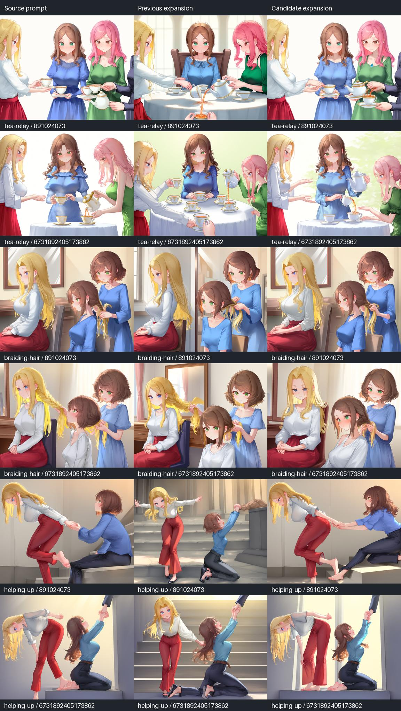
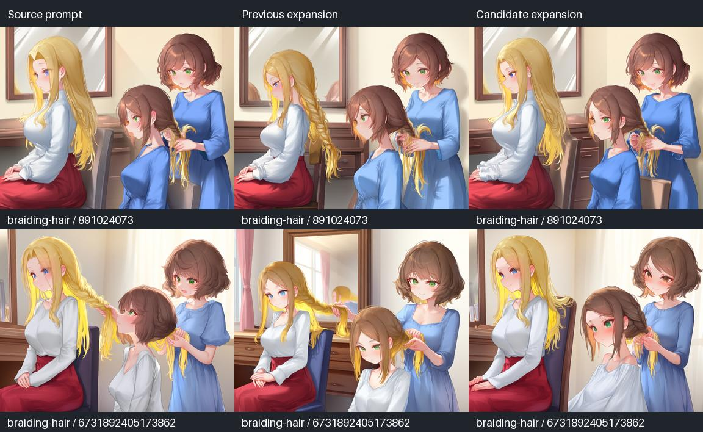

# 복잡한 상호작용의 역할 보강 시험

## 목적과 비교 조건

앞선 컵 전달·춤·등 맞대기보다 역할을 구별하기 어려운 조건에서,
TIPO의 추가 태그 선택이 도움이 되는지 확인했습니다.
생성할 때 전역 문장은 입력 그대로 고정하고 캐릭터별 STRING만 바꿨습니다.
전역 보강까지 포함한 전체 파이프라인의 성공률 시험은 아닙니다.

| 장면 | 캐릭터별 역할 | 어려운 점 |
|---|---|---|
| 3인 차 전달 | 왼쪽은 컵 건네기, 가운데는 받치기, 오른쪽은 주전자로 따르기 | 하나의 컵에 세 사람의 손동작이 모임 |
| 머리 땋기 | 앞에 앉아 머리 손질을 받는 사람, 뒤에서 땋는 사람 | 행동 대상이 상대의 머리이며 앞뒤로 겹침 |
| 잡아 일으키기 | 위쪽 계단에서 손을 끄는 사람, 아래에서 손을 잡고 일어나는 사람 | 위아래 높이·다른 자세·접촉이 동시에 필요 |

각 장면을 **원문 / 기존 보호만 적용한 보강 / 행동 근거·개수 상한을 적용한 보강**으로
비교했습니다. 여기서 기존 보강은 같은 후보에 `grounded_additions=False`를 적용한
검사 경로이며, 출시 버전 전체를 다시 실행한 비교는 아닙니다.

- TIPO 공식 revision `f5a318524a4ab30cdbbf51816cf406170f454e65`, 텍스트 시드 8910,
  temperature 0, 캐릭터마다 최대 96토큰. 이전 선택/수정 선택은 생성 토큰 일치를 검사했습니다.
- Anima base v1.0, RSCV5 15,000 step LoRA 전역 강도 0.9.
- 1152×896, 30 steps, CFG 4, **Euler ancestral + SGM uniform**.
- 이미지 시드 `891024073`, `6731892405173862`의 두 개.
- 2인은 XY `(0.28, 0.5)`, `(0.72, 0.5)`;
  3인은 `(0.28, 0.5)`, `(0.50, 0.5)`, `(0.72, 0.5)`.
- 마스크·포즈 제어·디테일러는 사용하지 않았습니다. 특히 머리 땋기의 앞뒤 관계를
  좌우 포인트 두 개로 지정한 조건은 어려우며, 영역 배치를 개선하는 시험과 구분해야 합니다.
- 5060 전용 시험 서버에서 실행했습니다. 기존 4070 작업은 그대로 두었습니다.

## 발견한 코드 문제와 보완

외형 보호는 `hair`를 포함한 접촉 태그를 외형 변경으로 판단했고,
행동 근거 선택은 `hairdressing`을 요청한 동작과 연결하지 못했습니다.
공유 문맥에서도 `hair`를 포함한 행동이 외형 정보로 걸러졌습니다.
이 때문에 `hairdressing`, `holding another's hair` 같은 요청한 손질 동작도 제외됐습니다.

이번 변경은 원문에 머리 땋기·빗기·손질받기가 명시된 경우에만 좁은 영어 동작 문형을
허용합니다. 외형이 섞인 `braiding blue hair`, 요청하지 않은 `single braid` 등은 계속 차단합니다.
손질받는 사람에게 손질하는 동작을 옮기거나, 상대 머리를 손질하는 행동을
자기 머리 손질로 바꾸는 추가도 허용하지 않습니다.

이 예외는 무제한적인 의미 이해가 아닙니다. 등록된 영어 문형을 인식하는 보수적인 규칙입니다.
해당 동작을 공유 문맥에 보존하므로, 이 장면은 모델 후보 토큰 자체도 바뀔 수 있습니다.

## 관찰과 한계



| 장면 | 두 시드의 관찰 | 판단 |
|---|---|---|
| 3인 차 전달 | 세 사람은 유지되지만 여러 컵·주전자와 추가 손이 나타남. 수정안도 가운데 사람이 주전자를 드는 등 역할이 바뀜 | 소품·역할 중복을 해결하지 못했으며 두 시드에 걸친 일관된 개선 없음 |
| 머리 땋기, 코드 수정 전 | 원문과 두 보강 모두 세 사람으로 늘어남. 손질받는 인물의 머리색이 옮겨가는 사례도 보임 | 보강 이전부터 실패하는 배치이며 태그 필터만의 원인으로 볼 수 없음 |
| 잡아 일으키기 | 첫 시드의 기존 보강은 두 사람이 따로 팔을 뻗는 모습으로 변함. 원문·수정안은 손 접촉을 유지. 두 번째 시드에서는 수정안에도 비정상 자세·손이 남음 | 첫 시드의 접촉 유지에는 도움이 되지만 동작·인체 정확도를 해결하지 못함 |

수정 전 실제 TIPO 추가 태그 수는 차 전달 **29→3**, 머리 땋기 **14→2**,
잡아 일으키기 **11→2**입니다. 태그 수는 두 이미지 시드에 공통으로 사용한
한 번의 텍스트 결과 기준이며 이미지 성공률 수치가 아닙니다.

전체 장면에서 수정안이 기존 보강보다 낫다는 결론은 내리지 않습니다.
역할을 지정한 문장이 존재해도 이미지 모델이 그 관계와 신체 구조를 정확하게
실현하는 것은 별도 문제입니다. 좌우 포인트·전후 배치의 영향은 이 시험으로 분리하지 않았습니다.

최초 18장 큐 제출부터 파일 확인까지 약 38~44초/장으로 기록됐습니다.
서버 캐시·폴링·파일 읽기를 포함하므로 정밀한 생성 성능 비교가 아닙니다.

## 머리 손질 보완 후 추가 확인

원문이 같아도 공유 행동 문맥이 수정돼 TIPO 생성 후보가 바뀔 수 있으므로
실제 TIPO를 다시 실행하고, 두 시드에서 기존 선택/수정 선택을 **4장 추가 생성**했습니다.
각 실행 안의 기존/수정 선택은 같은 생성 토큰을 사용합니다.
수정 전후 TIPO 토큰까지 동일하다는 의미는 아닙니다.



수정안은 `hairdressing`을 추가했습니다. 접촉·머리 손질 태그가 외형 보호에
잘못 걸리는 문제는 회귀 검사와 실제 출력으로 확인했습니다.
그러나 **추가 네 장 모두 거울 속 반사 외에도 인물 몸체가 세 개로 늘었습니다.**
중앙 인물의 머리색도 섞였고 눈색·의상 불일치가 남았습니다.
코드 보완을 이 장면의 이미지 성공으로 해석하지 않습니다.

총 22장, 한 모델·한 스타일 LoRA·세 장면·두 시드의 탐색입니다.
수정 후 Python 자동 검사 **75개**, JS 검사 파일 **3개**가 통과했습니다.
자동 검사는 역할 보호 동작을 검증하며 이미지 품질을 자동 판정하지 않습니다.
UI 구조나 저장 형식은 이번에 바꾸지 않았고, 구형 ComfyUI를 다시 실행하지 않았습니다.

## 재현 자료

- [장면별 원문](role-complex/cases.json)
- [수정 전 TIPO 출력과 토큰](role-complex/prompts-before.json)
- [수정 전 18장 API 그래프·시드·prompt ID·픽셀 SHA-256·파일 위치](role-complex/images-before.json)
- [머리 손질 보완 후 TIPO 출력과 토큰](role-complex/prompts-hair-after.json)
- [보완 후 네 장 실행 그래프·시드·픽셀 SHA-256](role-complex/images-hair-after.json)

이미지 원본은 manifest의 로컬 파일 위치에 보존했습니다. 저장소에는 비교 이미지와
실행 그래프를 남겼으며, 원본 생성은 해당 모델·스타일 LoRA가 있어야 재현됩니다.

```bash
python tools/validate_role_additions.py /path/to/TIPO-model --cases docs/role-complex/cases.json --output validation/complex-prompts.json
python tools/validate_role_images.py validation/complex-prompts.json --url http://127.0.0.1:8197 --output validation/complex-images --seeds 891024073 6731892405173862
python tools/role_contact_sheet.py validation/complex-images/results.json --output validation/complex-comparison.jpg
```

이 스크립트의 이미지 시험은 큐가 비었고 장치가 5060인 지정 서버에서만 실행합니다.

이 시험은 한 이미지 모델·한 스타일 LoRA·두 시드의 탐색입니다.
추가 태그가 줄었다는 수치를 이미지 품질 향상이나 성공률로 해석하지 않습니다.

